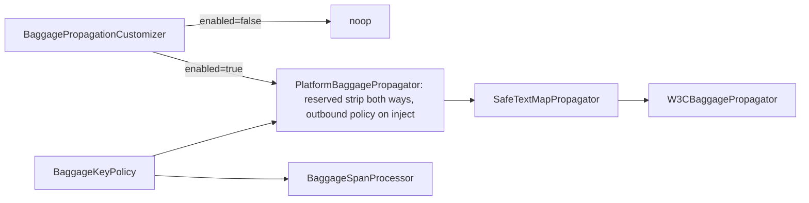

# Baggage: allowlist пропагаторов и единая политика ключей

## Статус ревью, четвёртый круг

ACCEPT WITH CHANGES, три правки текста, все приняты после проверки по коду.

- **Positive control в SDK-тесте.** Подтверждено: `TraceControlPropagator.inject` — no-op (строки 57–61). Параметризация переведена на `tracecontext,baggage[,имя]` с обязательным `traceparent`.
- **`otel.propagators` в `OtelSdkPropertyNames`.** Класс существует в `configuration` и содержит `otel.bsp.*`. Ключ переносится туда.
- **Прецедент сигнатуры.** `SamplerConfigurationContract.normalize` и `requireFinal` принимают `ConfigProperties` статически. Записано в срезе 1 с уточнением, что прецедент лежит в другом пакете.

## Статус ревью, третий круг

Два внешних ревью: ACCEPT WITH CHANGES, четыре совпадающие правки. Все приняты. Правка 1 принята с исправленным размещением.

- **Владение `otel.propagators`.** Предложенное место «рядом с `SamplerConfigurationContract`» — это пакет `bootstrap.session`. Проверено grep: `bootstrap` уже зависит от `propagation`, а `propagation` от `bootstrap` не зависит. Импорт контракта из `bootstrap.session` в `propagation` создал бы цикл.
  - Поэтому контракт размещается в `configuration`. Пакет `configuration` не импортирует ни `propagation`, ни `bootstrap`, а `propagation → configuration` уже существует (`BaggagePropagationCustomizer → BaggageExtensionConfig`).
  - Правила `AgentPlaneIsolationArchTest` о `ConfigProperties` касаются только классов `*ExtensionConfig` и полей. Статический метод с параметром `ConfigProperties` их не нарушает.
  - Литерал `platform-trace-control` переносится в контракт, `TraceControlPropagatorProvider.NAME` ссылается на него. Иначе `configuration` зависел бы от `propagation`.
  - Формулировка «единственный владелец ключа» неверна и заменена: контракт — единственный владелец множества имён, ключ лежит в `OtelSdkPropertyNames` (четвёртый круг); читателей ключа два, `PlatformPropagatorsDefaultsCustomizer` и контракт.
- **Deny в SDK-тесте: принято.** Allowlist в тесте расширяется до `traffic_source,access_token`, в context добавляется `access_token`.
- **`KNOWN_AGENT_PROPAGATORS`: принято.** Множество проверено ранее по `inst/META-INF/services/...ConfigurablePropagatorProvider` агента 2.32.0: `b3`, `b3multi`, `jaeger`, `ottrace`, `xray`, `xray-lambda`.
- **Обе ветки declarative config: принято.** Ветка `configureFromSpi` подтверждена байткодом `maybeConfigureFromFile` (offsets 0–25) ещё во втором круге. Обе ветки пропускают ACP, и обе закрываются `PLATFORM_ACP_NOT_EXECUTED`, поэтому формулировка ADR обобщается. Запрет `DeclarativeConfigurationCustomizerProvider` объявляется scope этого плана, а не архитектурной позицией.

## Статус ревью, второй круг

Вердикт внешнего ревью: ACCEPT WITH CRITICAL FIXES. Каждое утверждение проверено Grok-субагентами по коду и по jar. Ниже для каждого пункта указано, принят он, исправлен или отклонён.

- **Фикс 1, исполняемый инвариант: принят.** Прежний план ошибался: `b3` резолвится в тестах. Standalone-артефакт `opentelemetry-extension-trace-propagators-1.66.0` содержит `META-INF/services/...ConfigurablePropagatorProvider` (`b3`, `b3multi`, `jaeger`, `ottrace`). `AutoConfigurationCustomizerTestClassLoader` (строки 12–30) скрывает только SPI ACP. Поэтому `testRuntimeOnly` даёт SPI-резолв и одновременно запрещает импорт классов в тестах.
- **Фикс 2, declarative config: обход уже fail-closed и уже покрыт.** Новый код и новый child-process тест не нужны.
  - В агенте 2.32.0 непустой `otel.config.file` (`OTEL_CONFIG_FILE` нормализуется в тот же ключ) пропускает ACP: `AutoConfiguredOpenTelemetrySdkBuilder.maybeConfigureFromFile`.
  - `ActivationAgentListener.afterAgent` при этом всё равно вызывается. `BootstrapTerminalTransitions.failMissingPreparation` (строки 163–192) публикует `FAILED` / `PLATFORM_ACP_NOT_EXECUTED`.
  - Spring получает `EXTENSION_FAILED`, и `AgentStartupVerifier.enforceContract` не стартует контекст. Это верно как при `enabled=true`, так и при `enabled=false`: во втором случае срабатывает `CONTROLLED_AGENT_FORBIDDEN`.
  - Существующий child-JVM тест `InvalidExtensionConfigurationTest.declarative_configuration_file_fails_bootstrap_without_platform_export` (строки 261–292) уже утверждает `lifecycle=FAILED` и `PLATFORM_ACP_NOT_EXECUTED`. Он включается в gate. В ADR и `SUPPORTED.md` фиксируется: declarative config не поддерживается, агент не READY.
- **Helm `OTEL_CONFIG_FILE` в `managedOtelNames`: отклонено.** Список означает «значение задаёт платформа» (сообщение `is managed by platform-tracing`), а `OTEL_CONFIG_FILE` платформа не задаёт. Запрет уже исполняется runtime-гейтом с тестом, второй источник истины не нужен.
- **Единая классификация ошибок: принято, механизм другой.** Проверено, что `ConfigurationPropertyException` внутри `bootstrap.execute` теряет `propertyName`. `execute` (строки 211–225) этот тип не разбирает, а `terminalizeCustomizationFailure` передаёт `propertyName = null`. Сохраняет имя свойства только `createPreparedSession` (строки 192–198). Поэтому проверка имён переносится в подготовку сессии, а не оборачивается в `execute`. Подготовка вызывается из resource customizer, после properties customizers и до `configurePropagators` (`buildImpl`, offsets 113–149). Все три ошибки оператора (имя пропагатора, regex, reserved-ключ) получают один код `CONFIGURATION_INITIALIZATION_FAILED`, фазу `configuration-validation` и имя свойства.
- **`b3multi`: остаётся.** Исполняемый тест делает обязательство аудита дешёвым.
- **Reserved-ключ после `toLowerCase(Locale.ROOT)`: принято.**
- **Identity `Context` в `inject`: принято.**
- **`attributeKeyFor`: принято, подтверждён дефект.** Кэш ключуется `normalizedKey`, имя строится из исходного `key` (`BaggageSpanProcessor.java:106-109`), первый встреченный регистр фиксируется навсегда.
- **Запасной пакет `BaggageKeyPolicy`: принято**, `space.br1440.platform.tracing.otel.javaagent.baggage`.
- **Покрытие метрики `safe_wrapper.failures` в ADR: принято.**
- **Тест identity `extract`: принято.**
- **Тест `none`: уже покрыт.** `PlatformPropagatorsDefaultsCustomizerTest` проверяет пустой override, интеграционный тест проверяет SDK с `none`. Upstream при `none` не вызывает propagator customizer (`configurePropagators`, offsets 40–76). Новая проверка имён должна допускать `none`. Существующие тесты остаются в gate.
- **Gate: исправлено.** Autoconfigure-модуль не меняется и из todo убран. Добавлен целевой прогон дистрибутива.

## Проверенные факты прежнего ревью (сохраняются)

- Агент 2.32.0 регистрирует `b3`, `b3multi`, `jaeger`, `ottrace`, `xray`, `xray-lambda`.
- `AwsXrayPropagator.inject` пишет `baggage` через синглтон `W3CBaggagePropagator.getInstance()` в обход customizer.
- Jaeger и OtTrace помечены `@Deprecated` и пишут `uberctx-*` / `ot-baggage-*`. B3 не ссылается на `Baggage`.
- `W3CBaggagePropagator.inject` при пустом baggage делает `return`.
- Helm `tracecontext,baggage,b3` берётся из Instrumentation CR в Infra (коммит `164a1d62`).
- Матчер `BaggageSpanProcessor` повторяет `FilteringBaggagePropagator.isAllowed`.
- `ExtensionDefaults.java:45` противоречит `FailClosed`.

Отклонены ранее и остаются отклонены: ArchUnit-запрет пакетов extension/contrib, ArchUnit-правило на `Pattern`, `Safe` снаружи объединённого пропагатора, обёртки сторонних пропагаторов.

## Срез 1: allowlist имён `otel.propagators`

Новый `space.br1440.platform.tracing.otel.javaagent.configuration.PropagatorConfigurationContract` (`public final`, без состояния) — единственный владелец множества имён. Upstream-ключ `otel.propagators` добавляется в существующий [OtelSdkPropertyNames.java](e:/Platform_Traces/platform-starters-tracing/platform-tracing-otel-javaagent-extension/src/main/java/space/br1440/platform/tracing/otel/javaagent/configuration/OtelSdkPropertyNames.java), где уже собраны имена `otel.bsp.*`. Контракт и `PlatformPropagatorsDefaultsCustomizer` ссылаются на эту константу, своих литералов ключа не держат.

```java
// OtelSdkPropertyNames (configuration) получает: public static final String PROPAGATORS = "otel.propagators";
public static final String NONE = "none";
public static final String PLATFORM_PROPAGATOR = "platform-trace-control";
public static final Set<String> SUPPORTED_PROPAGATORS =
        Set.of("tracecontext", "baggage", "b3", "b3multi", PLATFORM_PROPAGATOR, NONE);

public static void requireSupported(ConfigProperties config) {
    // unsupported -> throw new ConfigurationPropertyException(OtelSdkPropertyNames.PROPAGATORS,
    //         new ConfigurationException("otel.propagators contains unsupported propagators "
    //                 + unsupported + "; supported: " + sorted SUPPORTED_PROPAGATORS));
}
```

- Направление зависимостей: `propagation → configuration` и `bootstrap.session → configuration`. Обратных рёбер нет, новый цикл не возникает.
- [PlatformPropagatorsDefaultsCustomizer.java](e:/Platform_Traces/platform-starters-tracing/platform-tracing-otel-javaagent-extension/src/main/java/space/br1440/platform/tracing/otel/javaagent/propagation/PlatformPropagatorsDefaultsCustomizer.java) берёт `OtelSdkPropertyNames.PROPAGATORS`, а `NONE` и `PLATFORM_PROPAGATOR` — из контракта и остаётся функцией дефолтов. Регистрация на строке 59 остаётся без `execute`.
- `TraceControlPropagatorProvider.NAME` ссылается на `PropagatorConfigurationContract.PLATFORM_PROPAGATOR`, чтобы литерал существовал в одном месте.
- Сравнение регистрозависимое, как у upstream `NamedSpiManager`. Сообщение детерминировано: множество выводится отсортированным.
- Вызов `PropagatorConfigurationContract.requireSupported(config)` добавляется в `AutoconfigureSessionFactory.create` рядом с `SamplerConfigurationContract`. Внутри `createPreparedSession` `ConfigurationPropertyException` ловится существующим catch.
- Прецеденты сигнатуры: `SamplerConfigurationContract.normalize(ConfigProperties)` (строка 23) и `requireFinal(ConfigProperties)` (строка 34) — статические методы без поля `ConfigProperties`, но в пакете `bootstrap.session`. В самом `configuration` единственный разрешённый держатель `ConfigProperties` — `ExtensionConfigReader` (`ConfigurationOwnershipArchTest`, строки 107–125). Контракт поля не держит.
- Риск: если `ConfigurationOwnershipArchTest` или `AgentPlaneIsolationArchTest` отвергнет размещение, контракт переносится в новый пакет `javaagent.propagation.config` без зависимостей на `bootstrap`. Правила не ослабляются.
- Семантика отказа существующая: bootstrap `FAILED`, Spring не стартует. Новый knob не вводится.
- `build.gradle:84`: `testImplementation` заменяется на `testRuntimeOnly 'io.opentelemetry:opentelemetry-extension-trace-propagators'`.

## Срез 2: единая политика ключей



- `BaggageKeyPolicy`, `public final`, в пакете `configuration`. Если ArchUnit не допускает его туда, класс переносится в `javaagent.baggage`, правила не ослабляются.
  - Хранит lower-case set и скомпилированные паттерны.
  - `allows(String key)`: `null` даёт `false`.
  - `isEmpty()` нужен для shortcut процессора.
- [BaggageExtensionConfig.java](e:/Platform_Traces/platform-starters-tracing/platform-tracing-otel-javaagent-extension/src/main/java/space/br1440/platform/tracing/otel/javaagent/configuration/BaggageExtensionConfig.java):
  - строит `outboundHeaderPolicy()` и `spanAttributesPolicy()`;
  - невалидный regex даёт `ConfigurationPropertyException` с именем свойства;
  - ключ, который после `toLowerCase(Locale.ROOT)` равен `platform.correlation.id`, в `outbound-header.allowed-keys` даёт `ConfigurationPropertyException`;
  - неиспользуемые списочные accessors удаляются.
- [ExtensionDefaults.java](e:/Platform_Traces/platform-starters-tracing/platform-tracing-otel-javaagent-extension/src/main/java/space/br1440/platform/tracing/otel/javaagent/configuration/ExtensionDefaults.java):45 — из outbound-дефолта убирается `CORRELATION_ID`. Span-дефолт не меняется.
- [BaggageSpanProcessor.java](e:/Platform_Traces/platform-starters-tracing/platform-tracing-otel-javaagent-extension/src/main/java/space/br1440/platform/tracing/otel/javaagent/processor/BaggageSpanProcessor.java):
  - конструктор принимает `BaggageKeyPolicy`, `matchesDeny` удаляется;
  - `attributeKeyFor` строит `ATTRIBUTE_PREFIX + normalizedKey`;
  - отсев blank, ветка correlation и shortcut остаются;
  - `PlatformSpanProcessorFactory.baggageProcessor` передаёт `spanAttributesPolicy()`.

## Срез 3: один baggage-пропагатор

- `PlatformBaggagePropagator` (package-private, `propagation`) заменяет `FilteringBaggagePropagator` и `FailClosedCorrelationBaggagePropagator`. Оба класса удаляются.
  - `inject`: `requireNonNull(context)`, затем фильтр policy и снятие reserved-ключа. Если ни одна запись не удалена, в `delegate.inject` передаётся исходный `context`, иначе `context.with(filtered)`. Delegate вызывается всегда, ранних `return` нет.
  - `extract`: `requireNonNull(context)`, затем `delegate.extract`. Если результат `null`, бросается NPE. Затем снимается reserved-ключ. Если ключа не было, возвращается тот же `Context`. Allowlist на входе не применяется.
- [BaggagePropagationCustomizer.java](e:/Platform_Traces/platform-starters-tracing/platform-tracing-otel-javaagent-extension/src/main/java/space/br1440/platform/tracing/otel/javaagent/propagation/BaggagePropagationCustomizer.java) возвращает `new PlatformBaggagePropagator(new SafeTextMapPropagator(propagator), baggage.outboundHeaderPolicy())`.
- `PropagationAndMdcBoundaryArchTest.propagationDecoratorsAreNotPublic` (строки 67–75): Filtering и FailClosed заменяются на `PlatformBaggagePropagator`.

## Тесты

- **Исполняемый инвариант** в `PlatformPropagationAutoconfigureIntegrationTest`.
  - Параметризация: базовый случай `tracecontext,baggage` и `tracecontext,baggage,<имя>` для каждого имени из `SUPPORTED_PROPAGATORS \ {none, baggage, tracecontext}`, то есть `b3`, `b3multi`, `platform-trace-control`.
  - Голые пары «имя + `baggage`» не используются. `TraceControlPropagator.inject` — преднамеренный no-op (строки 57–61, outbound принадлежит `PlatformOutboundPropagation.resolve`). Пара `platform-trace-control,baggage` дала бы пустой carrier, а утверждение «нет `baggage`» без positive control прошло бы и при несобранном composite.
  - На каждый случай свой `baseBuilder()`, то есть новый coordinator, иначе `SECOND_SDK_BUILD`.
  - В context кладётся валидный sampled `SpanContext`: без него trace-пропагаторы ничего не пишут, и positive control невозможен.
  - Через `addPropertiesSupplier` задаётся `platform.tracing.baggage.outbound-header.allowed-keys=traffic_source,access_token`.
  - В context кладётся baggage с `traffic_source`, `access_token`, `platform.correlation.id`, `password_x`. Каждый механизм политики отсекает свой ключ: allow отсекает `password_x`, deny-паттерн `token` отсекает `access_token`, reserved отсекает `platform.correlation.id`.
  - Positive control в обоих состояниях флага: всегда есть `traceparent`. Для `b3` дополнительно заголовок `b3`, для `b3multi` — `X-B3-TraceId`.
  - `enabled=false`: в carrier нет `baggage`.
  - `enabled=true`: `baggage` содержит только `traffic_source`.
  - Состав параметров сверяется с `SUPPORTED_PROPAGATORS \ {none, baggage, tracecontext}` отдельным assert, чтобы новое имя в allowlist без теста роняло gate. `tracecontext` покрыт базовым случаем.
- **Отказ** через тот же builder: `jaeger`, `ottrace`, `tracecontext,jaeger`, `JAEGER` дают `BootstrapException` с кодом `CONFIGURATION_INITIALIZATION_FAILED`, в цепочке cause есть сообщение с именем. Со SPI `jaeger` в `testRuntimeOnly` upstream принял бы это имя, поэтому тест доказывает именно платформенный отказ.
- **`PropagatorConfigurationContractTest`**:
  - константа `KNOWN_AGENT_PROPAGATORS = Set.of("b3", "b3multi", "jaeger", "ottrace", "xray", "xray-lambda")` с комментарием-источником `opentelemetry-javaagent 2.32.0, inst/META-INF/services/io.opentelemetry.sdk.autoconfigure.spi.ConfigurablePropagatorProvider`. Константа пересверяется при каждом bump агента;
  - параметризованный отказ по отклоняемым именам с проверкой `propertyName()` и имени в сообщении;
  - зеркальный assert: множество отклоняемых имён в тесте равно `KNOWN_AGENT_PROPAGATORS \ SUPPORTED_PROPAGATORS`;
  - `xray` и `xray-lambda` проверяются только здесь: их SPI в тестовом classpath нет;
  - `none`, `tracecontext,baggage,b3,platform-trace-control` и пустое значение проходят.
  - Дополнительно проверяется наличие `propertyName=otel.propagators`, если оно доступно через существующий тестовый fixture журнала. Это сверяется на реализации.
- **`PlatformBaggagePropagatorTest`**: перенос `FailClosedCorrelationBaggagePropagatorTest`, `FilteringBaggagePropagatorInjectionTest`, `FilteringBaggagePropagatorBaggageLimitsTest`. Новые случаи:
  - extract `platform.correlation.id=evil,traffic_source=x` оставляет только `traffic_source`;
  - extract без reserved-ключа возвращает тот же `Context` (`isSameAs`);
  - reserved-ключ не уходит в заголовок даже при policy, которая его разрешает (пакетный конструктор);
  - сохраняются `injectWithNullContextPropagatesExceptionBeforeDelegateIsInvoked` и `extractWithDelegateReturningNullPropagatesException`.
- **`BaggageKeyPolicyTest`**: регистр, `find()` как подстрока, `null`.
- **`BaggageExtensionConfigTest`**: невалидный regex; `platform.correlation.id` и `Platform.Correlation.Id` в outbound allowlist дают `ConfigurationPropertyException`; дефолт без correlation.
- **`BaggagePropagationCustomizerTest`**: `isInstanceOf` заменяется проверкой carrier, `assembledChain_..._characterization` становится контрактным тестом.
- **`BaggageSpanProcessorTest`**: `Tenant_Class` и затем `tenant_class` дают атрибут `baggage.tenant_class` в обоих span.

## Docs (Platform_Traces_Docs)

- `architecture/identity/adr-baggage-outbound-propagation.md`:
  - строки 15–18: новая цепочка;
  - строка 34: allowlist и отклонённые имена с причиной для xray;
  - раздел «Зарезервированные ключи»;
  - исключения `PlatformBaggagePropagator` не считаются в `platform.tracing.safe_wrapper.failures{component=propagator}`, так как у него нет источников исключений кроме контрактного NPE на `null`;
  - любой путь, при котором ACP не выполнен, даёт `PLATFORM_ACP_NOT_EXECUTED`: агент не READY, Spring не стартует. Это относится к declarative config через `otel.config.file` / `OTEL_CONFIG_FILE` и через SPI-провайдер модели (`DeclarativeConfigUtil.configureFromSpi`). Доказательство — `InvalidExtensionConfigurationTest`;
  - миграция ACP на `DeclarativeConfigurationCustomizerProvider` — отдельное будущее решение. Агент движется к declarative config как основному пути. Текущий отказ — граница поддержки, а не постоянный архитектурный запрет.
- `docs/decisions/ADR-config-precedence.md:49-56` и `ADR-named-spi-sampler-propagator.md:90-95`: строка «неподдерживаемое имя → `CONFIGURATION_INITIALIZATION_FAILED`, `propertyName=otel.propagators`».
- `docs/SUPPORTED.md:153-159`: допустимое множество, у `b3` потребитель «Instrumentation CR в Infra»; declarative config не поддерживается ни через файл, ни через SPI-провайдер модели.
- `docs/tracing/otel-compatibility-matrix.md:112`: исправить «B3 в production не конфигурируется».
- `docs/analysis/platform-tracing-autoconfigure-configuration-reference.md`: дефолт `outbound-header.allowed-keys`, строка `OTEL_PROPAGATORS` (260).

## Запрещено

- Обёртки сторонних пропагаторов, идентификация по имени класса или `fields()`.
- `opentelemetry-extension-trace-propagators` в `implementation`, `compileOnly`, `testImplementation`. Допустим только `testRuntimeOnly`.
- Проверка имён через `bootstrap.execute`: она теряет `propertyName`.
- Новый fail-mode knob, деградация вместо отказа.
- `DeclarativeConfigurationCustomizerProvider` в рамках этого плана. Это ограничение scope, а не архитектурная позиция (см. ADR).
- Ослабление ArchUnit-правил ради размещения `BaggageKeyPolicy` или `PropagatorConfigurationContract`.
- `PropagatorConfigurationContract` в `bootstrap.session`: создаёт цикл `bootstrap ↔ propagation`.
- Изменение Helm-шаблонов.

## Gate

```powershell
.\gradlew.bat :platform-starters-tracing:platform-tracing-otel-javaagent-extension:test -PrunTests --offline --no-daemon
.\gradlew.bat :platform-starters-tracing:platform-tracing-otel-javaagent-distribution:controlledAgentRuntimeTest --tests space.br1440.platform.tracing.otel.javaagent.distribution.InvalidExtensionConfigurationTest --offline --no-daemon
git diff --check
```

Ожидание: оба прогона зелёные, включая ArchUnit. Счётчики берутся из XML-результатов. gRPC qualification не запускается. Если прогон дистрибутива не исполнился, статус фикса 2 — `INSUFFICIENT_EVIDENCE`, а не PASS.
